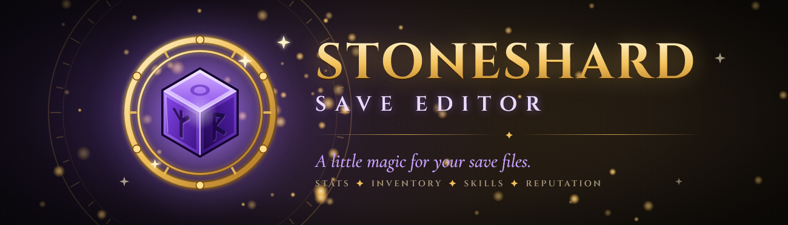
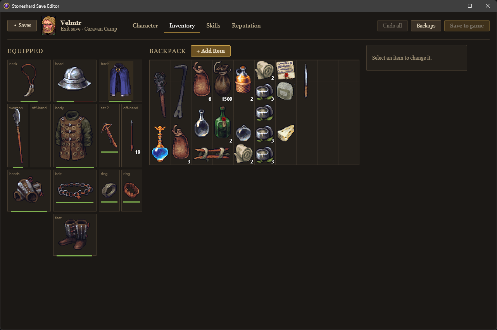
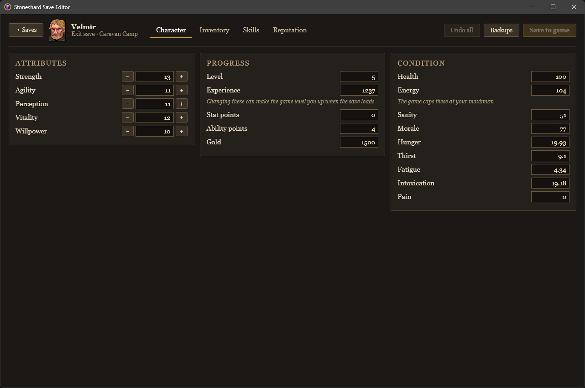
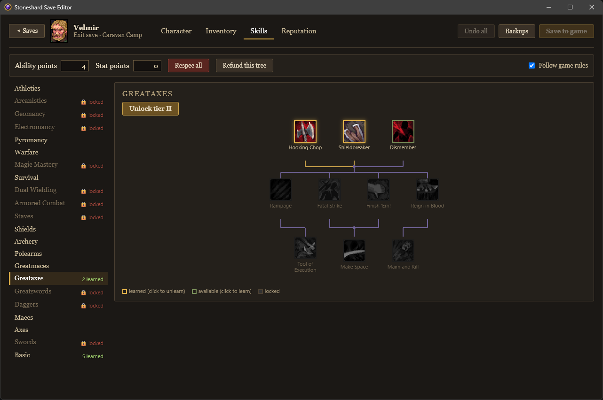
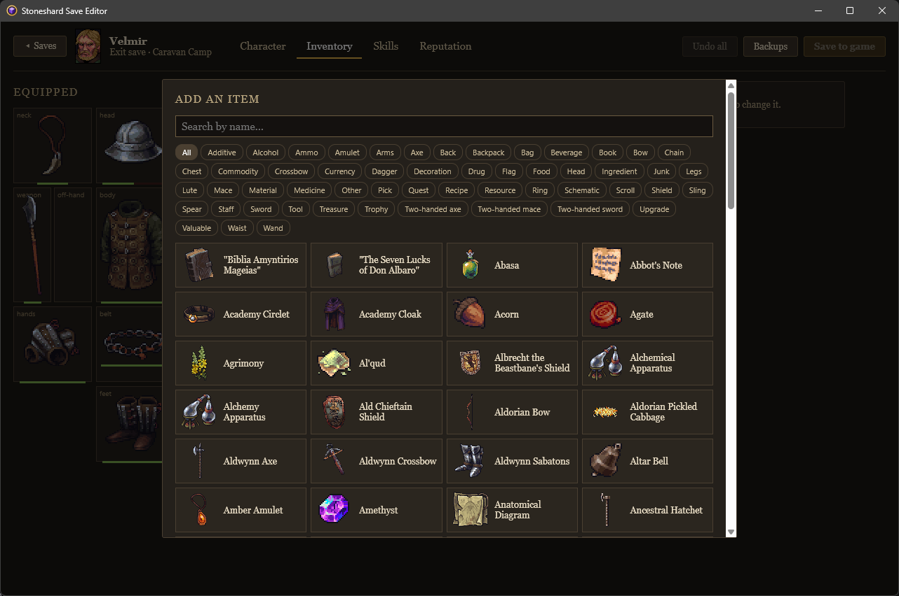
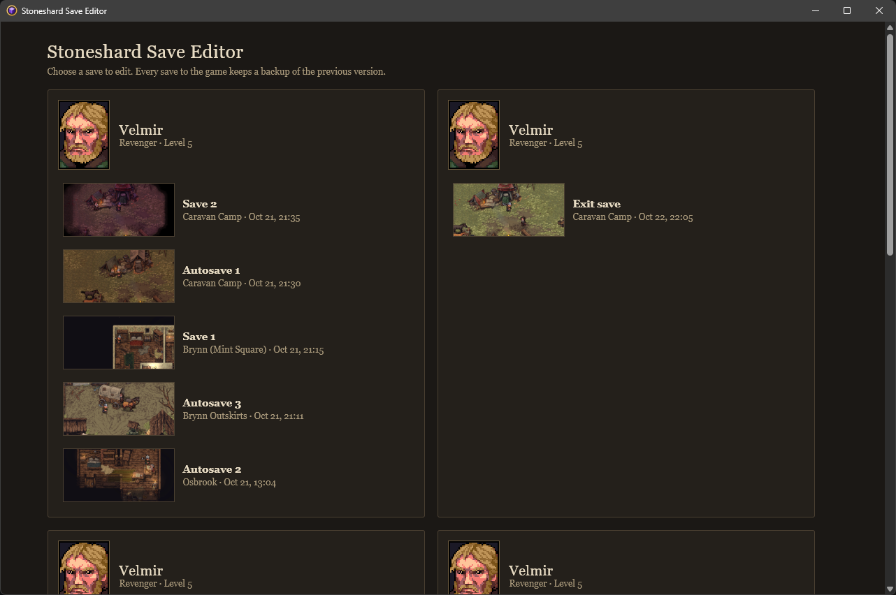

<p align="center">
  
</p>

<p align="center">
  <a href="https://github.com/MrAmadis/stoneshard-save-editor/releases/latest"><b>⬇ Download the latest version</b></a>
  &nbsp;·&nbsp;
  <a href="https://www.nexusmods.com/stoneshard/mods/423">Nexus Mods page</a>
  &nbsp;·&nbsp;
  <a href="https://github.com/MrAmadis/stoneshard-save-editor/issues">Report a bug</a>
</p>

A save editor for [Stoneshard](https://store.steampowered.com/app/625960/Stoneshard/) that looks like the game. Pick a save, change your character, and save back. The editor finds your saves on its own and backs up each save before writing to it, so you can always go back.

<p align="center">
  
</p>

## What you can edit

**Character**
- Attributes, level, XP, stat and ability points, and gold
- Condition: health, energy, sanity, morale, hunger, thirst, fatigue, intoxication and pain

**Inventory**
- Add **any item in the game** from a catalog you can search by name, with the game's own icons
- Change stack size, charges and durability; duplicate or delete items
- **Drag and drop** to equip, unequip, swap or rearrange. Slots that fit light up, the backpack shows where the item will land, and the editor refuses moves the game wouldn't allow.

**Skills**
- Unlearn skills and get the points back, or refund a whole tree at once
- Learn skills directly in the editor
- Unlock a closed tree, or its next tier as if you'd read the treatise
- A *Follow game rules* switch decides whether skill prerequisites apply

**Reputation**
- Set your standing with each settlement

## Safe to use

- **Automatic backups.** Every save to the game backs up the previous version first. The **Backups** button restores any of them.
- **Saves the game accepts.** The editor writes the checksum the game expects and leaves everything you didn't edit unchanged. Its edits were checked by loading the saves in the game.
- **No accidents.** It won't save while Stoneshard is running, and saves in a format it doesn't know open read-only.
- **Hands off your game.** It changes no game files, ships no game art and connects to nothing online. Icons and item data are read from your own install.

## Requirements

- **Windows 10 or 11**, 64-bit. Nothing to install: .NET is built into the exe.
- **Microsoft Edge WebView2 Runtime.** Windows 11 includes it, and most Windows 10 PCs already have it. If it's missing, the editor says so and opens [Microsoft's download page](https://developer.microsoft.com/microsoft-edge/webview2/).
- **Stoneshard 0.9.4.25** (save format 0.9), on the default Steam branch or the modbranch.

## How to use

1. Close Stoneshard.
2. Download `StoneshardSaveEditor-<version>.zip` from the [latest release](https://github.com/MrAmadis/stoneshard-save-editor/releases/latest), unzip it anywhere and double-click `StoneshardSaveEditor.exe`.
3. Pick a save. The first start reads the game files and takes a few seconds.
4. Make your changes and click **Save to game**.
5. Start Stoneshard and load the save.

**Undo all** drops your unsaved changes. **Backups** lists the earlier versions of the open save and restores any of them.

> [!NOTE]
> **"Windows protected your PC"?** The exe isn't signed, so Windows asks first. Click **More info**, then **Run anyway**.
>
> Some antivirus tools also flag it. It is a self-contained, single-file .NET program: the app and the .NET runtime are packed into one exe that unpacks itself on first run, which scanners often distrust. You can [build it yourself](#building-from-source) from this repository instead.

### Game not found?

The editor finds Steam installs on any drive by itself. For any other copy (for example GOG), click **Choose game folder…** on the save list and pick the folder that contains `StoneShard.exe`. The editor remembers it. GOG copies haven't been tested yet, so please [report how it goes](https://github.com/MrAmadis/stoneshard-save-editor/issues).

Without the game files you can still edit stats, gold and reputation, but item icons, adding items and the Skills tab need them.

## Screenshots

| | |
|:-:|:-:|
|  |  |
| Character: attributes, progress and condition | Skills: learn, unlearn and unlock trees |
|  |  |
| Add any item from the game's catalog | Your characters and saves, found on their own |

## Not supported (yet)

- Linux and Steam Deck
- The caravan stash, quests, the world map and other parts of the save outside the tabs above
- Moving items into or out of containers such as purses and quivers
- Mods: the editor runs on the modbranch, but items that mods add may be missing from the **Add item** catalog

## Where things are, and uninstalling

| What | Where |
|---|---|
| Your saves (the game's own folder) | `%LOCALAPPDATA%\StoneShard\characters_v1` |
| Backups | `%LOCALAPPDATA%\StoneShardSaveEditor\backups` |
| Settings and icon cache | `%LOCALAPPDATA%\StoneShardSaveEditor` |
| Files the exe unpacks on first run | `%TEMP%\.net\StoneshardSaveEditor` |

To uninstall, delete the exe. To remove everything, also delete `%LOCALAPPDATA%\StoneShardSaveEditor` (this deletes the backups too) and `%TEMP%\.net\StoneshardSaveEditor`.

## Building from source

You need Windows and the [.NET 10 SDK](https://dotnet.microsoft.com/download/dotnet/10.0) (10.0.401 or later).

```powershell
git clone https://github.com/MrAmadis/stoneshard-save-editor.git
cd stoneshard-save-editor

# Run the editor
dotnet run --project src/StoneshardSaveEditor.App

# Run the tests
dotnet test --solution StoneshardSaveEditor.slnx

# Build the single-file exe the releases ship, into artifacts\StoneshardSaveEditor.exe
dotnet publish src/StoneshardSaveEditor.App -c Release -r win-x64 --self-contained -p:PublishSingleFile=true -p:IncludeNativeLibrariesForSelfExtract=true -p:EnableCompressionInSingleFile=true -p:Version=1.0.1 -o artifacts
```

Some tests need the game installed and skip when it isn't. They look for it in `D:\SteamLibrary\steamapps\common\Stoneshard`; point them elsewhere with the `STONESHARD_DIR` environment variable. Tests that need a snapshot of real saves (`tests/fixtures/real/`, not in the repository) skip as well.

### How it works

A Stoneshard save is a zlib stream holding the save's JSON, followed by an MD5 checksum of that JSON plus a salt that depends on the save's folder. The editor decodes it, changes only the values you edit, recomputes the checksum and writes the file back. Item data, icons, skill trees and names come from the game's own `data.win` and `StoneShard.exe`, read-only.

The interface is made of Blazor components, shown in a WinForms window through WebView2.

| Project | What it does |
|---|---|
| `src/StoneshardSaveEditor.Core` | Save files: decoding, encoding, backups, and the edits themselves |
| `src/StoneshardSaveEditor.GameData` | Reads the game install: item catalog, icons, skill trees, translations |
| `src/StoneshardSaveEditor.UI` | The screens and tabs, as Blazor components |
| `src/StoneshardSaveEditor.App` | The desktop window, and the exe |
| `tools/StoneshardSaveEditor.Lab` | A developer tool for in-game experiments: test characters, dumping and diffing saves |
| `tests/` | xUnit and bUnit tests |

The design notes, plans and in-game test results are in [`docs/`](docs/).

## Credits

- [denbkh's stoneshard-save-editor](https://github.com/denbkh/stoneshard-save-editor) documented the save checksum.
- Built with .NET, ASP.NET Core, WebView2 and SharpZipLib. Their licenses are in `THIRD-PARTY-NOTICES.txt` in each release download.
- Made with the help of Claude, an AI coding assistant.

Stoneshard is a game by Ink Stains Games. This is a fan-made tool, not affiliated with or endorsed by its developers or publishers.
